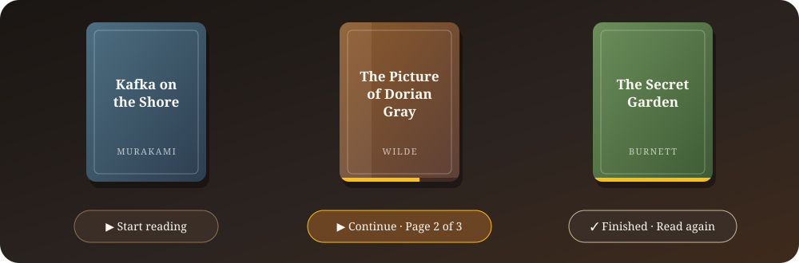
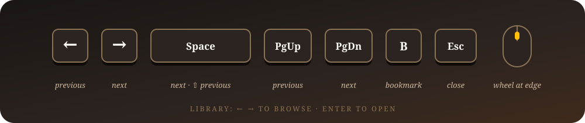
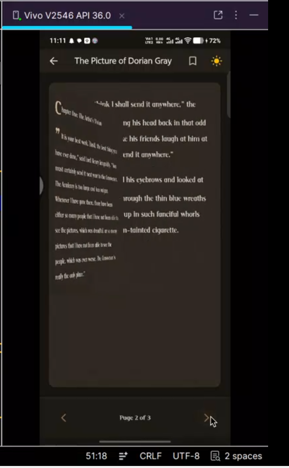
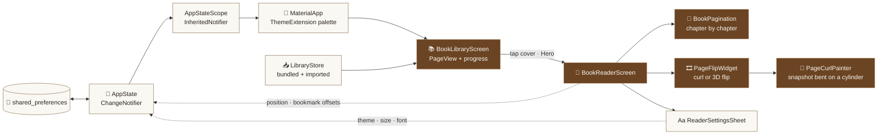

<div align="center">


<a href="https://github.com/HammasT1/Animated_Book">
  
</a>

<br/>


<br/>


<a href="https://github.com/HammasT1/Animated_Book/actions/workflows/build-apk.yml"></a>

<br/><br/>

<b>
<a href="#-about">About</a> ·
<a href="#-whats-new">What's New</a> ·
<a href="#-preview">Preview</a> ·
<a href="#-features">Features</a> ·
<a href="#%EF%B8%8F-shortcuts">Shortcuts</a> ·
<a href="#-under-the-hood">Under the Hood</a> ·
<a href="#-getting-started">Getting Started</a> ·
<a href="#%EF%B8%8F-roadmap">Roadmap</a>
</b>

</div>


## 📖 About

**Animated Book** is a Flutter reading experience that treats every page like real paper.
Browse a swipeable shelf of leather-bound covers, tap one to watch it **expand into the reader through a Hero transition**, then **drag or flick to turn pages** with a perspective-correct 3D hinge that follows your finger.

Pick **light, sepia or candlelit dark** paper, set the **text size, line spacing and typeface** you like, and close the app whenever you want: your **page, bookmarks and settings are waiting** when you come back.


## 🆕 What's New

> [!TIP]
> **v1.1** is the reader's biggest update yet: a modular codebase, persistent state, a reading-settings panel, velocity-aware flicks and full keyboard & mouse support.

### 🌗 Paper & type, your way
Tap **Aa** in the reader to open the settings sheet. Every change applies live to the page behind it and cross-fades smoothly between themes.



### 👆 Flicks that feel physical
A short, fast swipe now turns the page, a quick flick back cancels it, and the turn **continues from the exact angle your finger let go** instead of restarting flat.



### 🔖 Pick up where you left off
Every cover shows how far through the book you are, and opening a book drops you on the sentence you were reading, even after changing the text size or rotating the screen. Bookmarks, theme and typography are saved the moment they change.



### ⌨️ Made for desktop & web too
Turn pages from the keyboard, bookmark with <kbd>B</kbd>, close with <kbd>Esc</kbd>. The scroll wheel reads long pages first and only turns the page at the edge.




## 🎬 Preview

<div align="center">

<table>
  <tr>
    <td align="center" width="33%">
      <br/>
      <sub><b>📚 My Library</b><br/>Swipeable book carousel</sub>
    </td>
    <td align="center" width="33%">
      <br/>
      <sub><b>🎞️ Live Demo</b><br/>Hero open &amp; page flip</sub>
    </td>
    <td align="center" width="33%">
      <br/>
      <sub><b>📖 Reader</b><br/>3D page turn &amp; drop caps</sub>
    </td>
  </tr>
</table>

</div>


## ✨ Features

<table>
  <tr>
    <td width="50%" valign="top">

### 🎞️ Motion
- **Two-page spread** on wide screens: the right page turns over the spine like a real leaf, with the next page on its back
- **Paper-like page curl**: the page bends around a cylinder, shows its translucent back, and casts shadows along the fold and onto the page beneath
- **3D page flip** built on `Matrix4` perspective transforms, switchable in settings
- **Drag-to-flip** with a live preview that tracks your swipe
- **Velocity-aware flicks**: fast swipes turn, fast reverse swipes cancel
- **Seamless hand-off**: the release continues from the drag angle
- **Direction-aware hinge**: flips forward *and* backward
- **Page-turn sound and haptics**: a soft paper rustle as a page turns and a light tap as it lands, each switchable in settings
- **Hero cover transition** and a **staged reveal** of the reader chrome

    </td>
    <td width="50%" valign="top">

### 📚 Reading
- **Swipeable library** of book covers via `PageView`
- **Add your own books** from `.txt` or `.epub` files, with the title, author and cover read from the file (or a generated leather cover)
- **Continue reading** with progress on every cover
- **Per-page bookmarks** with a ribbon on the page
- **Bookmarks list** with a preview of each page and one-flip jump-to-page
- **Illuminated drop caps** that scale with your text size
- **Pages that fit your screen**: the text re-flows into pages whenever the window, text size, spacing or typeface changes, and you stay on the same sentence
- **Page counter** (`Page x of y`) in the nav tray

    </td>
  </tr>
  <tr>
    <td width="50%" valign="top">

### 🎨 Design
- **Light · Sepia · Dark** paper, cross-faded via `ThemeExtension`
- **Reader settings**: page turn (curl or flip, sound, vibration), text size 14–28, line spacing 1.4–2.2
- **Serif or Sans** typeface, both bundled with the app
- Textured paper, layered shadows and gradients

    </td>
    <td width="50%" valign="top">

### 💾 Remembers everything
- Your **imported books**, kept on the device
- Last page read in **every book**
- **Bookmarks**, paper style and typography
- Written through to `shared_preferences` instantly
- Survives the app being closed at any moment

    </td>
  </tr>
  <tr>
    <td width="50%" valign="top">

### ⌨️ Keyboard & mouse
- Arrows, <kbd>Space</kbd>, <kbd>PgUp</kbd>/<kbd>PgDn</kbd> turn pages
- <kbd>B</kbd> bookmarks, <kbd>Esc</kbd> closes the book
- Scroll wheel turns pages
- Browse the shelf with <kbd>←</kbd>/<kbd>→</kbd>, open with <kbd>Enter</kbd>

    </td>
    <td width="50%" valign="top">

### ⚡ Performance & quality
- Pure Flutter, **zero third-party animation packages**
- Page text is built once per page, not once per frame
- Smooth on 60 Hz and 120 Hz displays
- Widget & unit tests for flips, flicks and persistence

    </td>
  </tr>
</table>


## ⌨️ Shortcuts

<div align="center">

| Where | Keys | Action |
|:--|:--|:--|
| 📖 Reader | <kbd>→</kbd> · <kbd>PgDn</kbd> · <kbd>Space</kbd> | Next page |
| 📖 Reader | <kbd>←</kbd> · <kbd>PgUp</kbd> · <kbd>Shift</kbd>+<kbd>Space</kbd> | Previous page |
| 📖 Reader | <kbd>B</kbd> | Toggle bookmark |
| 📖 Reader | <kbd>Shift</kbd>+<kbd>B</kbd> | Open the bookmarks list |
| 📖 Reader | <kbd>Esc</kbd> | Back to library |
| 📖 Reader | 🖱️ Scroll wheel | Turn the page |
| 📚 Library | <kbd>←</kbd> · <kbd>→</kbd> | Browse books |
| 📚 Library | <kbd>Enter</kbd> · <kbd>Space</kbd> | Open the selected book |
| 📚 Library | <kbd>Ctrl</kbd>+<kbd>O</kbd> | Add a book (`.txt` / `.epub`) |

</div>


## 🎨 Colour Palette

<div align="center">

</div>

| Token | Hex | Where it's used |
|:--|:--:|:--|
|  **Leather** | `#6B4423` | Light theme seed, drop caps, icons |
|  **Walnut** | `#8B7355` | Dark theme seed, secondary accents |
|  **Sand** | `#CBB69B` | Dark mode drop caps & highlights |
|  **Parchment** | `#FAF8F3` | Light surface / paper |
|  **Sepia** | `#F6EEDC` | Sepia paper |
|  **Sepia Ink** | `#5B4636` | Sepia body text |
|  **Espresso** | `#2C2420` | Headings (light) · paper (dark) |
|  **Night** | `#1A1613` | Dark surface |
|  **Amber** | `#FFC107` | Progress bars, sun icon in dark mode |


## 🧠 Under the Hood



<details>
<summary><b>📖 How the two-page spread works</b></summary>
<br/>

1. When the reading area is at least 960 px wide and clearly landscape (tablets, desktop and web windows), the book opens flat with two pages and a shaded gutter at the spine. Phones turned sideways keep one page, because two pages there would each be only a few lines tall.
2. Pages pair up **within each chapter**, so a chapter always opens on a left page, and one with an odd number of pages ends on a blank right page, as in a printed book. Spreads stay the same however much of a long book has been paginated.
3. A turn is a leaf rotating about the spine with `Matrix4.rotateY`. Until it stands upright it shows its front (the current right page). After that it shows its back (the next left page), landing on the other side. It is shaded as it tilts and casts a shadow on the pages beneath.
4. Bookmarks, progress and the page label ("Pages 3–4 of 120") cover both pages. Narrowing the window switches back to one page at the same sentence.

</details>

<details>
<summary><b>🔊 How the page-turn sound is made</b></summary>
<br/>

1. The three sounds in `assets/sounds/` are **synthesized**, not recorded, by `tool/generate_page_sounds.py` (pure Python, no dependencies). Each one is band-limited noise shaped into a paper swish with a little flutter and crackle, ending in a soft low tap as the page lands. Edit the script and run `python3 tool/generate_page_sounds.py` to change them.
2. Turns cycle through the three variations, each on its own `audioplayers` player, so quick turns don't cut each other off. Android uses the low-latency `SoundPool` path.
3. The sound respects the phone's silent mode and mixes with any music already playing instead of pausing it.
4. As the page settles, `HapticFeedback.lightImpact()` gives a light tap on devices that vibrate.
5. **Aa → Page-turn sound / Vibrate when a page lands** switches each one off, and the choice is saved.

</details>

<details>
<summary><b>📥 How books are imported</b></summary>
<br/>

1. Tap the **add** button in the library (or press <kbd>Ctrl</kbd>+<kbd>O</kbd>) and pick a `.txt` or `.epub` file. It's read in a background isolate, so a big book doesn't freeze the shelf.
2. **Text files** are decoded as UTF-8 (falling back to Latin-1). Project Gutenberg licence headers and footers are removed, and the title and author come from the header. Hard-wrapped lines are joined back into paragraphs, while short lines such as verse keep their breaks. Headings like "CHAPTER IV" start new chapters.
3. **EPUBs** are unzipped with `archive`. `container.xml` and the package file (read with `xml`) give the title, author, cover image and the chapters in spine order. Each chapter's HTML becomes plain paragraphs. DRM-protected books are rejected with a clear message.
4. Very long chapters are split at a paragraph so each stays quick to lay out.
5. Books are saved as JSON (plus the cover) in the app's private folder on Android and desktop, or in browser storage on the web. A book imported twice is stored once, and keeps your place.
6. Imported books can be removed with **Remove from library**, or by long-pressing the cover. Their reading position and bookmarks are removed too.

</details>

<details>
<summary><b>📜 How the page curl works</b></summary>
<br/>

1. After any frame in which the page changes, the flat page is captured from its `RepaintBoundary` with `toImageSync()`, at full device resolution.
2. While the page turns, the live page is hidden and `PageCurlPainter` redraws the snapshot in thin vertical strips with `drawImageRect`.
3. Each strip is placed by `CurlGeometry`: the free edge of the paper wraps around an upright cylinder whose base (the fold) slides across the page as the turn progresses. Past the top of the cylinder the paper has folded over and lies flat on top.
4. Strips are shaded by how far they face away from the reader. Strips showing the back get a paper-coloured wash, so the page's own text shows through faintly, mirrored, like real paper.
5. Gradient shadows fall onto the uncovered page beneath, along the fold, and where the folded flap meets the page.
6. The same drag, flick and release logic drives both the curl and the flip, so the curl also continues from wherever your finger let go.

</details>

<details>
<summary><b>🔍 How the page flip works</b></summary>
<br/>

1. A horizontal drag accumulates `_dragOffset` (clamped to ±200 px) and tilts the page up to 0.3 rad as a live preview.
2. The sign of the offset sets `_isFlippingForward`, which moves the hinge to the left or right edge.
3. The rotation is applied with `Matrix4.identity()..setEntry(3, 2, 0.0009)..rotateY(angle)` for real perspective.
4. On release, the drag's tilt is converted into controller progress (`dragOffsetToFlipProgress`) so the animation **continues from where the finger left off**.
5. The page turns if the drag passed **70 px** *or* was flung faster than **600 px/s** in the same direction. A fast fling the other way cancels. Faster flings finish faster.
6. Otherwise the page eases back flat in 220 ms instead of snapping.
7. The page underneath (next or previous) is already rendered, so the reveal never stutters.

</details>

<details>
<summary><b>📐 How pages are cut to fit</b></summary>
<br/>

1. Each book is one continuous text. When the reader knows its page size (from a `LayoutBuilder`), `paginate()` lays the text out as a `ui.Paragraph` built from exactly the span and style the page is drawn with (pages are drawn with `RichText`, not `Text.rich`, whose surrounding default style would make every line slightly taller), so lines break in the same places as on screen.
2. About 12,000 characters are laid out at a time and many pages are cut from each layout: `computeLineMetrics()` gives each line's height, and a binary search over `getLineNumberAt()` finds where each page's first line starts. Pages break between words or after a hyphen. A whole novel paginates in well under a second.
3. Chapters always start on a new page, so each chapter is paginated on its own. Only the chapter you're reading is paginated before the page appears. The rest are filled in one per frame interval (never during an animation), and until then the tray shows a percentage instead of "Page x of y".
4. A paragraph that carries over from the previous page doesn't get a second drop cap.
5. Progress and bookmarks are stored as **character offsets**, not page numbers. After a re-flow the reader opens whichever new page holds their offset, so they never lose their place.
6. Colours are left out of the pagination key, so a theme cross-fade doesn't re-paginate on every frame.

</details>

<details>
<summary><b>🖱️ How the scroll wheel knows when to turn</b></summary>
<br/>

Flutter's `PointerSignalResolver` gives a scroll event to the **first** widget that claims it, and a `Scrollable` only claims it when it can actually move. Pages are sized to fit, so the wheel normally turns the page straight away. If a page ever does overflow (for example while a font is still loading), the text scrolls first and the page turns at the edge. A 900 ms cooldown stops trackpad momentum from flipping several pages at once.

</details>

<details>
<summary><b>🧰 Flutter APIs used</b></summary>
<br/>

`AnimationController` · `Tween` · `CurvedAnimation` · `Interval` · `AnimatedBuilder` · `Transform` · `Matrix4` · `Hero` · `PageView.builder` · `GestureDetector` · `Listener` · `PointerSignalResolver` · `CallbackShortcuts` · `Focus` · `ChangeNotifier` · `InheritedNotifier` · `ListenableBuilder` · `ThemeExtension` · `SegmentedButton` · `Slider` · `showModalBottomSheet` · `Text.rich` · `TextPainter` · `LayoutBuilder` · `RepaintBoundary.toImageSync` · `CustomPainter` · `ui.Paragraph` · `compute` · `file_picker` · `audioplayers` · `HapticFeedback` · `archive` · `xml` · `path_provider` · `ColorScheme.fromSeed` · `shared_preferences`

</details>


## 📲 Download

Ready-to-install APKs are built automatically by GitHub Actions:

- **Stable:** grab the latest APK from [**Releases**](https://github.com/HammasT1/Animated_Book/releases/latest)
- **Latest build:** open the most recent [**Build APK** run](https://github.com/HammasT1/Animated_Book/actions/workflows/build-apk.yml) and download the `AnimatedBook-APKs` artifact

> [!NOTE]
> Not sure which file to pick? Use **`arm64-v8a`** for most modern phones, or **`universal`** if you're unsure.

## 🚀 Getting Started

> [!IMPORTANT]
> **Prerequisites:** Flutter 3.x (Dart ≥ 3.9) and Android Studio or VS Code. Run `flutter doctor` to check your setup.

```bash
# 1 · Clone
git clone https://github.com/HammasT1/Animated_Book.git
cd Animated_Book

# 2 · Install dependencies
flutter pub get

# 3 · Run
flutter run
```

<details>
<summary><b>📦 Build, test &amp; device commands</b></summary>
<br/>

| Task | Command |
|:--|:--|
| List devices | `flutter devices` |
| Run on a device | `flutter run -d <device_id>` |
| Analyze | `flutter analyze` |
| Run tests | `flutter test` |
| Debug APK | `flutter build apk` |
| Release APK | `flutter build apk --release` |
| Web build | `flutter build web` |
| Windows build | `flutter build windows` |

</details>

### 🗂️ Project Structure

```text
Animated_Book/
├── lib/
│   ├── main.dart                      # Loads saved state, builds MaterialApp
│   ├── models/book.dart               # Book model with a stable id
│   ├── data/library.dart              # The books on the shelf
│   ├── state/app_state.dart           # Settings, bookmarks & progress (persisted)
│   ├── theme/app_theme.dart           # Light / sepia / dark palettes & fonts
│   ├── screens/
│   │   ├── library_screen.dart        # Cover carousel + continue reading
│   │   └── reader_screen.dart         # Gestures, flicks, keyboard & wheel
│   └── widgets/
│       ├── page_flip.dart             # 3D hinge, paper texture, drop caps
│       ├── reader_settings_sheet.dart # The "Aa" panel
│       └── theme_toggle_button.dart   # Sun / moon toggle
├── test/widget_test.dart              # Flip, flick, resume & persistence tests
├── assets/
│   ├── fonts/                         # Serif & Sanseriffic typefaces
│   ├── images/                        # Covers, paper texture, screenshots
│   └── readme/                        # Animated SVGs for this README
└── pubspec.yaml
```


## 🗺️ Roadmap

- [x] Modular codebase with a single app state
- [x] Saved bookmarks, theme and reading progress
- [x] Continue reading from the library
- [x] Reader settings: paper, size, spacing, typeface
- [x] Velocity-aware flicks
- [x] Keyboard & mouse controls
- [x] Pages re-flow to fit the screen and your typography
- [x] Two-page spread in landscape and on desktop
- [x] Page-curl effect with a shadow along the fold
- [x] Bookmarks list with jump-to-page
- [x] Load real books from files (`.txt` / `.epub`)
- [x] Page-turn sound and haptics
- [ ] Search inside a book and a chapter list
- [ ] Highlights and margin notes

## 🤝 Contributing

Contributions, ideas and bug reports are welcome.

1. **Fork** the repository
2. Create a branch: `git checkout -b feature/amazing-idea`
3. Check your change: `flutter analyze && flutter test`
4. Commit: `git commit -m "Add amazing idea"`
5. Push: `git push origin feature/amazing-idea`
6. Open a **Pull Request** 🎉

## ⭐ Support

If this project helped or inspired you, please give it a **star**. It helps others find it.

<div align="center">

<br/>

**Crafted with ☕ & 🤎 by [Muhammad Hammas Rasheed](https://github.com/HammasT1)**


</div>
