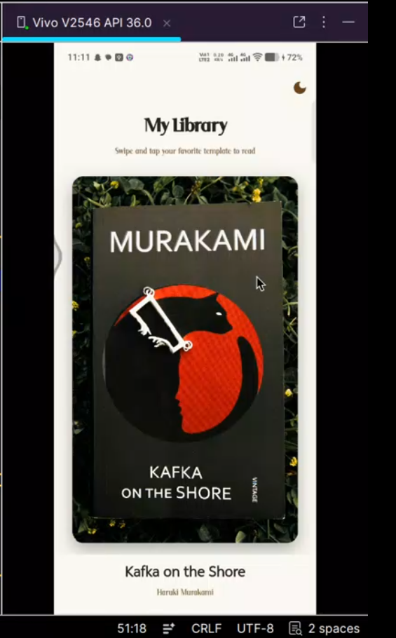
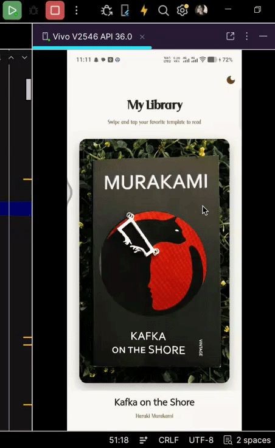
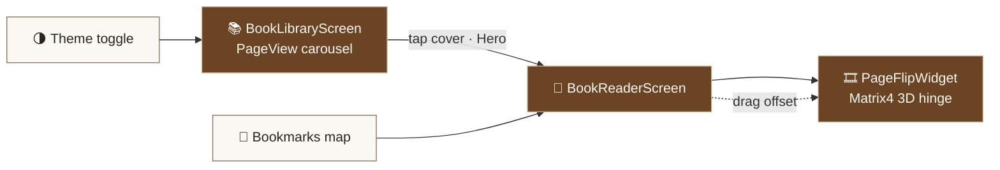

<div align="center">



<a href="https://github.com/HammasT1/Animated_Book">
  
</a>

<br/>


<a href="https://github.com/HammasT1/Animated_Book/actions/workflows/build-apk.yml"></a>

<br/><br/>

<b>
<a href="#-preview">Preview</a> ·
<a href="#-features">Features</a> ·
<a href="#-colour-palette">Palette</a> ·
<a href="#-under-the-hood">Under the Hood</a> ·
<a href="#-getting-started">Getting Started</a> ·
<a href="#-contributing">Contributing</a>
</b>

</div>


## 📖 About

**Animated Book** is a Flutter reading experience that treats every page like real paper.
Browse a swipeable shelf of leather-bound covers, tap one to watch it **expand into the reader through a Hero transition**, then **drag to turn pages** with a perspective-correct 3D hinge that follows your finger.

The whole UI is dressed in a warm **leather-and-parchment palette** with an elegant serif type system, illuminated drop caps, and a candlelit dark mode.


## 🎬 Preview

<div align="center">

<table>
  <tr>
    <td align="center" width="33%">
      <br/>
      <sub><b>📚 My Library</b><br/>Swipeable book carousel</sub>
    </td>
    <td align="center" width="33%">
      <br/>
      <sub><b>🎞️ Live Demo</b><br/>Hero open &amp; page flip</sub>
    </td>
    <td align="center" width="33%">
      <br/>
      <sub><b>📖 Reader</b><br/>3D page turn &amp; drop caps</sub>
    </td>
  </tr>
</table>

</div>


## ✨ Features

<table>
  <tr>
    <td width="50%" valign="top">

### 🎞️ Motion
- **3D page flip** built on `Matrix4` perspective transforms
- **Drag-to-flip** with a live preview that tracks your swipe
- **Direction-aware hinge**: flips forward *and* backward
- **Hero cover transition** from shelf to reader
- **Staged reveal**: reader chrome rises and fades in once the cover lands

    </td>
    <td width="50%" valign="top">

### 📚 Reading
- **Swipeable library** of book covers via `PageView`
- **Per-page bookmarks** with instant toggle
- **Illuminated drop caps** on every paragraph
- **Page counter** (`Page x of y`) in the nav tray
- **Custom serif typography** for a printed-book feel

    </td>
  </tr>
  <tr>
    <td width="50%" valign="top">

### 🎨 Design
- **Material 3** themes seeded from leather brown
- **Light ⇄ Dark** toggle: parchment by day, espresso by night
- Textured backgrounds, layered shadows and gradients

    </td>
    <td width="50%" valign="top">

### ⚡ Performance
- Pure Flutter, **zero third-party animation packages**
- `AnimatedBuilder` keeps rebuilds scoped to what moves
- Smooth on 60 Hz and 120 Hz displays

    </td>
  </tr>
</table>


## 🎨 Colour Palette

<div align="center">

</div>

| Token | Hex | Where it's used |
|:--|:--:|:--|
|  **Leather** | `#6B4423` | Light theme seed, drop caps, icons |
|  **Walnut** | `#8B7355` | Dark theme seed, secondary accents |
|  **Sand** | `#CBB69B` | Dark mode drop caps & highlights |
|  **Parchment** | `#FAF8F3` | Light surface / paper |
|  **Espresso** | `#2C2420` | Headings (light) · paper (dark) |
|  **Night** | `#1A1613` | Dark surface |
|  **Amber** | `#FFC107` | Sun icon in dark mode |


## 🧠 Under the Hood



<details>
<summary><b>🔍 How the page flip works</b></summary>
<br/>

1. A horizontal drag accumulates `_dragOffset` (clamped to ±200 px) and tilts the page as a live preview.
2. The sign of the offset sets `_isFlippingForward`, which moves the hinge to the left or right edge.
3. The rotation is applied with `Matrix4.identity()..setEntry(3, 2, 0.0009)..rotateY(angle)` for real perspective.
4. On release past a 70 px threshold, a 650 ms `AnimationController` with `Curves.easeInOutQuad` completes the turn; otherwise the page snaps back.
5. The page underneath (next or previous, depending on direction) is already rendered, so the reveal never stutters.

</details>

<details>
<summary><b>🧰 Flutter APIs used</b></summary>
<br/>

`AnimationController` · `Tween` · `CurvedAnimation` · `Interval` · `AnimatedBuilder` · `Transform` · `Matrix4` · `Hero` · `PageView.builder` · `GestureDetector` · `Stack` / `Positioned` · `RichText` / `WidgetSpan` · `ThemeData` (Material 3) · `ColorScheme.fromSeed`

</details>


## 📲 Download

Ready-to-install APKs are built automatically by GitHub Actions:

- **Stable:** grab the latest APK from [**Releases**](https://github.com/HammasT1/Animated_Book/releases/latest)
- **Latest build:** open the most recent [**Build APK** run](https://github.com/HammasT1/Animated_Book/actions/workflows/build-apk.yml) and download the `AnimatedBook-APKs` artifact

> Not sure which file to pick? Use **`arm64-v8a`** for most modern phones, or **`universal`** if you're unsure.

## 🚀 Getting Started

> **Prerequisites:** Flutter 3.x (Dart ≥ 3.9) and Android Studio or VS Code. Run `flutter doctor` to check your setup.

```bash
# 1 · Clone
git clone https://github.com/HammasT1/Animated_Book.git
cd Animated_Book

# 2 · Install dependencies
flutter pub get

# 3 · Run
flutter run
```

<details>
<summary><b>📦 Build &amp; device commands</b></summary>
<br/>

| Task | Command |
|:--|:--|
| List devices | `flutter devices` |
| Run on a device | `flutter run -d <device_id>` |
| Debug APK | `flutter build apk` |
| Release APK | `flutter build apk --release` |
| Web build | `flutter build web` |
| Windows build | `flutter build windows` |

</details>

### 🗂️ Project Structure

```text
Animated_Book/
├── lib/
│   └── main.dart          # App, themes, library, reader & page-flip widget
├── assets/
│   ├── fonts/             # Serif & Sanseriffic typefaces
│   ├── icons/             # Bookmark, sun, moon, type SVGs
│   ├── images/            # Covers, paper texture, screenshots
│   └── readme/            # Animated banner, palette & dividers for this README
└── pubspec.yaml
```


## 🤝 Contributing

Contributions, ideas and bug reports are welcome.

1. **Fork** the repository
2. Create a branch: `git checkout -b feature/amazing-idea`
3. Commit: `git commit -m "Add amazing idea"`
4. Push: `git push origin feature/amazing-idea`
5. Open a **Pull Request** 🎉

## ⭐ Support

If this project helped or inspired you, please give it a **star**. It helps others find it.

<div align="center">

<br/>

**Crafted with ☕ & 🤎 by [Muhammad Hammas Rasheed](https://github.com/HammasT1)**


</div>
